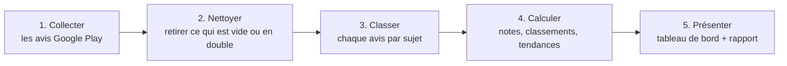

# 📱 Que pensent les utilisateurs de leurs applis d'argent mobile et de banque au Niger ?

Ce projet lit **32 586 avis** laissés sur Google Play pour **20 applications** (Wave, My Nita, My Airtel, Ecobank, MyBOA, Atlantique…) et en tire des conclusions simples : quelles applis plaisent, lesquelles déçoivent, et **pourquoi**.

| 👉 | Lien |
|---|---|
| **Tableau de bord interactif** (graphiques, classement, citations) | https://blakro.github.io/niger-fintech-reviews/ |
| **Rapport complet** (conclusions et recommandations) | [report/rapport_business.md](report/rapport_business.md) |

---

## ⏱️ Les résultats en 30 secondes

- **Le mobile money est mieux noté que les banques** : 4,5/5 contre 3,6/5. Mais en comparant les mêmes mois (mars à juillet 2026), l'écart est deux fois plus petit (4,6 contre 4,2). Les applis bancaires ont progressé.
- **Les mieux notées** : My Nita (4,7) et Wave (4,6). **Les moins bien notées** : My KEAZ d'Orabank (2,4, sur seulement 222 avis) et Ecobank Mobile (2,8).
- **Ecobank Mobile reçoit à elle seule près de la moitié (48 %) de toutes les plaintes.**
- **Plainte n° 1 : « je n'arrive pas à entrer dans mon compte »** (code qui n'arrive pas, compte bloqué, nouveau téléphone). Elle revient dans près d'1 avis négatif sur 3 (31 %).
- **Répondre ne suffit pas** : les entreprises répondent à 64 % des avis négatifs, mais 96 % de leurs réponses sont des messages copiés-collés, et l'appli la mieux notée ne répond jamais.

---

## 🔎 Comment ça marche ? Le processus en 5 étapes

Imaginez une **boîte à suggestions géante** posée à l'entrée de chaque agence. Ce projet fait le travail de la personne qui la vide chaque soir : elle lit tous les petits papiers, les trie par sujet, compte, puis présente un résumé au directeur.



### Étape 1 : Collecter les avis 📥

Un petit programme visite la page Google Play de chacune des 20 applis et **recopie les avis publics**, comme on photocopierait le livre d'or d'un restaurant.

Pour chaque avis, on garde :
- la **note** (de 1 à 5 étoiles) ;
- le **texte** écrit par l'utilisateur ;
- la **date** ;
- la **version de l'appli** utilisée (utile pour repérer les mises à jour ratées) ;
- la **réponse de l'entreprise**, s'il y en a une.

Trois règles encadrent la collecte :
- uniquement les avis **en français**, sur le **Google Play du Niger** ;
- au maximum les **5 000 avis les plus récents** par appli, pour que la collecte reste rapide ;
- si la connexion coupe en route, le programme **reprend là où il s'était arrêté**.

📄 Résultat : un grand tableau (comme un fichier Excel) de 32 587 lignes, une ligne par avis.

### Étape 2 : Nettoyer 🧹

On retire ce qui ne sert à rien (avis vides, doublons) et on **uniformise l'écriture**. On passe tout en minuscules et on enlève les accents, pour que « Bloqué », « bloque » et « BLOQUÉ » soient reconnus comme le même mot.

On repère aussi les **avis très courts** (« top », « très bien », « nul »). Ils représentent 45 % des avis. Ils comptent dans les notes, mais on ne peut pas savoir de quoi ils parlent.

### Étape 3 : Classer chaque avis par sujet 🗂️

C'est le cœur de l'analyse. Pour chaque sujet, on a établi une **liste de mots-clés**. Si un avis contient l'un de ces mots, il est rangé dans ce sujet. Un même avis peut parler de plusieurs sujets.

| Sujet | Exemples de mots-clés |
|---|---|
| Connexion / Accès | connexion, code, OTP (code reçu par SMS), mot de passe, compte bloqué, changer de téléphone |
| Inscription / Activation | inscription, créer un compte, enrôlement, activer, pièce d'identité |
| Mise à jour / Installation | mise à jour, nouvelle version, installer, télécharger |
| Bugs / Plantages | bug, plante, erreur, ne marche pas, ne s'ouvre pas |
| Transactions / Argent | transfert, retrait, dépôt, paiement, solde, argent |
| Carte bancaire | carte virtuelle, carte Visa |
| Frais / Tarifs | frais, tarif, commission, cher |
| Service client | service client, injoignable, réclamation, aucune réponse |
| Lenteur / Réseau | lent, lenteur, réseau, internet, chargement |
| Sécurité / Fraude | sécurité, arnaque, fraude, vol, piratage |
| Facilité / Rapidité *(compliments)* | facile, simple, pratique, rapide, efficace |

> ⚠️ **Le piège des mots cachés.** Le mot « lent » se cache dans « excel**lent** ». Une première version de l'analyse comptait donc les avis « Excellent ! » comme des plaintes de lenteur (plus de 1 000 avis mal rangés). Désormais, on ne cherche que des **mots entiers**. Une liste de phrases témoins est vérifiée automatiquement à chaque lancement : si « Excellent application » était à nouveau rangé dans « Lenteur », le programme s'arrêterait avec un message d'erreur.

### Étape 4 : Calculer les indicateurs 🧮

| Indicateur | Ce que ça veut dire, simplement |
|---|---|
| **Note moyenne** | La moyenne des étoiles (sur 5). |
| **% d'avis négatifs** | La part des avis à 1 ou 2 étoiles. (Un avis positif a 4 ou 5 étoiles ; 3 étoiles, c'est neutre.) |
| **Note ajustée** | Une note qui se méfie des applis qui ont peu d'avis. Un restaurant avec 2 avis à 5/5 n'est pas forcément meilleur qu'un restaurant avec 2 000 avis à 4,7/5. On fait donc « démarrer » chaque appli comme si elle avait déjà 50 avis moyens. Plus l'appli a d'avis, moins ce coup de pouce compte. |
| **Fourchette** | La marge d'erreur d'un pourcentage. « 15 % d'avis négatifs (9 à 22 %) » veut dire : avec si peu d'avis, la vraie valeur est probablement entre 9 et 22 %. Plus l'appli a d'avis, plus la fourchette est étroite. |
| **Période commune** | Une comparaison sur les **mêmes mois** pour tout le monde. Comme on ne garde que les 5 000 derniers avis, ceux de Wave ne couvrent que 4 mois alors que ceux d'une banque peuvent remonter à 2019. C'est comme comparer deux équipes de foot : il faut regarder la même saison. |
| **Tendance** | La note des 6 derniers mois comparée aux 6 mois précédents. ▲ = ça monte, ▼ = ça baisse. « Pas assez de recul » = la période précédente est incomplète ou compte trop peu d'avis. |
| **Principal motif de plainte** | Le sujet le plus cité dans les avis négatifs d'une appli. |
| **Note par version** | La satisfaction pour chaque version de l'appli, pour voir si une mise à jour a amélioré ou abîmé l'expérience. |
| **Messages types** | Les réponses de l'entreprise qui commencent par exactement la même phrase que d'autres réponses (copier-coller). |

### Étape 5 : Présenter 📊

Tous les chiffres sont rassemblés dans :
- un **tableau de bord interactif**, consultable dans n'importe quel navigateur, sur ordinateur ou téléphone : https://blakro.github.io/niger-fintech-reviews/ ;
- un **rapport écrit** avec les conclusions et les recommandations : [report/rapport_business.md](report/rapport_business.md).

Le tableau de bord est mis à jour **automatiquement** dès qu'on relance l'analyse : personne ne recopie les chiffres à la main.

---

## 🧭 Comment lire le tableau de bord

Tout en haut, **« À retenir »** donne les 4 messages clés : commencez par là. Juste en dessous, **« Les mots utilisés sur cette page »** explique le vocabulaire (note ajustée, fourchette, période commune…).

Viennent ensuite 7 parties, numérotées comme sur la page :

1. **Classement des applications** : choisissez une catégorie (banque ou mobile money) et un nombre minimum d'avis. Cliquez sur les titres du tableau pour le trier.
2. **Banques ou mobile money** : pourquoi l'écart est plus petit qu'il n'y paraît.
3. **Pourquoi les utilisateurs se plaignent** : les sujets de plainte, puis un tableau « application × sujet ». Plus la case est foncée, plus le sujet pèse.
4. **Évolution des principales applications** : la note mois par mois des 6 applis qui ont le plus d'avis.
5. **L'effet des mises à jour** : choisissez une appli pour voir sa note version par version.
6. **Les entreprises répondent-elles aux avis ?** : qui répond, et avec quels messages.
7. **Ce que disent les utilisateurs** : les avis les plus approuvés par les autres utilisateurs, sujet par sujet. Les noms des auteurs ne sont jamais affichés.

Sous la plupart des graphiques, **« Voir les données »** affiche les chiffres exacts sous forme de tableau.

---

## ⚠️ Ce que cette analyse ne dit pas

- **Ce n'est pas un sondage.** Les gens très contents ou très fâchés écrivent plus souvent un avis que les autres.
- **Une note qui monte n'est pas toujours une appli qui s'améliore.** Quand une appli se met à demander « Notez-nous ! », elle reçoit d'un coup beaucoup d'avis positifs, même si les problèmes restent. C'est pour ça qu'on regarde aussi le **nombre** de plaintes.
- **Tous les auteurs ne sont pas au Niger.** Wave, Airtel, Ecobank ou BOA existent dans plusieurs pays, et Google n'indique pas d'où vient l'auteur d'un avis.
- **Les mots-clés ne comprennent pas tout** : ni l'ironie, ni les avis écrits en haoussa ou en zarma.
- **Seuls les avis en français sont analysés.** C'est un choix du projet.
- **Les applis avec très peu d'avis** (moins de 100) sont affichées, mais leurs résultats sont fragiles.

---

## 🗂️ Où se trouve quoi ?

| Dossier / fichier | Contenu |
|---|---|
| `notebooks/scrape_playstore_reviews.ipynb` | **Étape 1** : le programme qui collecte les avis |
| `data/all_playstore_reviews.csv` | Les avis bruts, tels que collectés |
| `analysis/analyze_reviews.py` | **Étapes 2 à 4** : nettoyage, classement par sujet, calculs. La liste des mots-clés se trouve en haut de ce fichier. |
| `data/reviews_clean.csv` | Les avis nettoyés, avec leurs sujets |
| `analysis/aggregates.json` | Tous les chiffres calculés |
| `docs/index.html` + `docs/data.js` | **Étape 5** : le tableau de bord (`docs/chart.umd.min.js` est l'outil qui dessine les graphiques) |
| `report/rapport_business.md` | **Étape 5** : le rapport écrit |

---

## 🛠️ Pour les équipes techniques : refaire l'analyse

Prérequis : Python 3.10 ou plus récent.

```bash
pip install pandas google-play-scraper
```

**1. Collecter** : exécuter `notebooks/scrape_playstore_reviews.ipynb` (Colab ou Jupyter). Le dossier `checkpoints/` permet de reprendre après une coupure. Placer le fichier produit, `all_playstore_reviews.csv`, dans `data/`.

**2. Analyser** : cette commande régénère `data/reviews_clean.csv`, `analysis/aggregates.json` et `docs/data.js`.

```bash
python analysis/analyze_reviews.py
```

**3. Voir le résultat** : ouvrir `docs/index.html` dans un navigateur. Aucune connexion internet n'est nécessaire : la bibliothèque de graphiques (Chart.js 4.5.1, licence MIT) est incluse dans `docs/`.

**Modifier un réglage** : tous les paramètres (plafond, seuils, poids de la note ajustée, fenêtre de tendance) sont regroupés en haut de `analysis/analyze_reviews.py`, section « 1. PARAMÈTRES ». Pour corriger un classement par sujet, modifier le dictionnaire `THEMES` et ajouter une phrase témoin dans `LEXICON_TESTS`.

**Publication GitHub Pages** : Settings → Pages → Source : *Deploy from a branch* → branche `main`, dossier `/docs`. Le site se met à jour à chaque envoi sur `main`.
